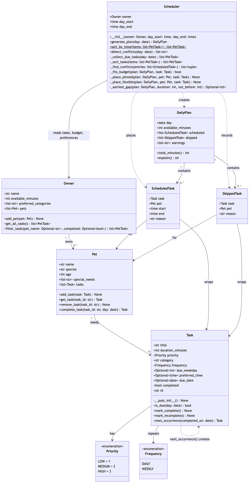

# PawPal+ (Module 2 Project)

You are building **PawPal+**, a Streamlit app that helps a pet owner plan care tasks for their pet.

## Scenario

A busy pet owner needs help staying consistent with pet care. They want an assistant that can:

- Track pet care tasks (walks, feeding, meds, enrichment, grooming, etc.)
- Consider constraints (time available, priority, owner preferences)
- Produce a daily plan and explain why it chose that plan

Your job is to design the system first (UML), then implement the logic in Python, then connect it to the Streamlit UI.

## What you will build

Your final app should:

- Let a user enter basic owner + pet info
- Let a user add/edit tasks (duration + priority at minimum)
- Generate a daily schedule/plan based on constraints and priorities
- Display the plan clearly (and ideally explain the reasoning)
- Include tests for the most important scheduling behaviors

## ✨ Features

Each feature is backed by a method in `pawpal_system.py` and covered by `tests/test_pawpal.py`.

- **Multi-pet planning**: one plan covers all of an owner's pets. Tasks travel as `(pet, task)` pairs so every entry remembers whose it is (`Owner.get_all_tasks`).
- **Priority ordering**: tasks are placed in order of highest priority first, then the owner's preferred categories (e.g. meds before walks), then shortest duration (`Scheduler._sort_tasks`).
- **Sorting by time**: tasks with a fixed start time are listed in time order, flexible tasks last. The sort is stable, so ties keep the order they were added in (`Scheduler.sort_by_time`).
- **Fixed-time tasks first, then gap filling**: tasks with a start time are placed at that time. Flexible tasks then go into the earliest free gap that is long enough (`_place_pinned`, `_place_flexible`, `_earliest_gap`).
- **Conflict warnings**: tasks whose requested times overlap get a plain warning that says whether it's the same pet or different pets. Tasks that only touch (08:00–08:30 and 08:30) don't count. It returns messages instead of crashing (`Scheduler.detect_conflicts`).
- **Automatic conflict resolution**: when two fixed-time tasks clash, the higher-priority one keeps its time and the other moves to the next free slot. If nothing is free before the day ends, it is skipped with a reason.
- **Time budget**: tasks are added until the owner's available minutes run out. One task too long for the remaining budget doesn't stop shorter tasks after it from fitting (`_fits_budget`).
- **Day window**: nothing is scheduled before the day starts or after it ends (08:00–20:00 by default). A fixed-time task that would run past the end of the day, or past midnight, is skipped instead of crashing.
- **Daily recurrence**: completing a daily task marks it done and adds a fresh copy due the next day, even across month and year boundaries (`Pet.complete_task`, `Task.next_occurrence`).
- **Weekly recurrence**: weekly tasks are only due on their weekday. Completing one schedules the next matching weekday: done early on Friday, a Sunday task is still due this Sunday, while done on Sunday it's due next Sunday.
- **Filtering**: show one pet's tasks, only to-do or only done tasks, or both (`Owner.filter_tasks`).
- **Explained plans**: every scheduled task says why it's there ("pinned to its preferred time", "moved from 18:00 because…"), and every skipped task says why it was left out (`DailyPlan.explain`).
- **Input checks**: tasks with zero or negative duration, weekly tasks with no weekday, and duplicate pet names are rejected with a clear message.

## 🛠️ Implementation Summary

PawPal+ plans a pet owner's day across **all of their pets**. The logic lives in `pawpal_system.py`; `main.py` is a terminal demo and `tests/test_pawpal.py` holds the tests.

**How the classes work together:**

1. **`Owner` → `Pet` → `Task`** hold the input data. An owner has a daily time budget, optional preferred categories, and one or more pets. Each pet keeps its own list of tasks. A `Task` has a title, duration, priority (`Priority` enum), category, frequency (`Frequency` enum: daily or weekly), an optional fixed start time, and a completion status.
2. **`Owner.get_all_tasks()`** returns every pet's tasks together as `(pet, task)` pairs, so each task keeps track of whose it is.
3. **`Owner.filter_tasks()`** narrows that list by pet and/or completion status, and **`Pet.complete_task()`** marks a task done and adds its next occurrence.
4. **`Scheduler.generate_plan(day)`** is the "brain." It reads only from `get_all_tasks()`, then:
   - warns about fixed-time tasks whose requested times overlap (`detect_conflicts`),
   - keeps tasks that are due that day (`Task.is_due`) and not completed,
   - sorts them by priority, then the owner's preferred categories, then shortest duration,
   - places tasks with a fixed time first; if two want the same slot, the later one moves to the next free time,
   - fills the remaining gaps with flexible tasks in sorted order,
   - skips anything that would exceed the time budget or run past the end of the day.
5. **`DailyPlan`** is the result: a list of `ScheduledTask`s (task, pet, start, end, reason) and `SkippedTask`s (task, pet, reason), plus `warnings` for overlapping fixed-time requests. `total_minutes()` reports time used, and `explain()` describes the plan in plain language.

The scheduler never changes the owner's data (only `Pet.complete_task` does), so the same owner can be planned for any day, and the UI only needs to display the `DailyPlan` it gets back. The final class diagram source is `diagrams/uml_final.mmd`:



## Getting started

### Setup

```bash
python -m venv .venv
source .venv/bin/activate  # Windows: .venv\Scripts\activate
pip install -r requirements.txt
```

### Suggested workflow

1. Read the scenario carefully and identify requirements and edge cases.
2. Draft a UML diagram (classes, attributes, methods, relationships).
3. Convert UML into Python class stubs (no logic yet).
4. Implement scheduling logic in small increments.
5. Add tests to verify key behaviors.
6. Connect your logic to the Streamlit UI in `app.py`.
7. Refine UML so it matches what you actually built.

## 🖥️ Sample Output

Output of `python main.py` (two pets, a 120-minute budget, tasks added out of time order, two deliberate time clashes, run on a Sunday so the weekly bath is due):

```
========================================================================
🐾 Today's Schedule for Jordan — Sunday, October 18, 2026
========================================================================
Time         Task              Pet     Priority  Why
------------------------------------------------------------------------
⚠ Conflict: Heartworm pill (Mochi) at 08:00 overlaps Breakfast (Luna) at 08:00 [different pets]
⚠ Conflict: Evening walk (Mochi) at 18:00 overlaps Dinner (Mochi) at 18:00 [same pet]
08:00-08:05  Heartworm pill    Mochi   high      pinned to its preferred time
08:05-08:15  Breakfast         Luna    high      moved from 08:00 because it overlapped Heartworm pill (Mochi)
08:15-08:45  Morning walk      Mochi   high      placed in the earliest free slot
08:45-09:00  Brush coat        Luna    low       placed in the earliest free slot
12:30-12:50  Play session      Luna    medium    pinned to its preferred time
18:00-18:30  Evening walk      Mochi   medium    pinned to its preferred time
18:30-18:40  Dinner            Mochi   medium    moved from 18:00 because it overlapped Evening walk (Mochi)
------------------------------------------------------------------------
Time used: 120 of 120 minutes

Skipped:
  ✗ Bath (Mochi): not enough time left in today's budget
========================================================================

All tasks in the order they were added:
  18:00    Evening walk      Mochi  to do
  flexible Bath              Mochi  to do
  flexible Morning walk      Mochi  to do
  08:00    Heartworm pill    Mochi  to do
  18:00    Dinner            Mochi  to do
  flexible Brush coat        Luna   to do
  12:30    Play session      Luna   to do
  flexible Clean litter box  Luna   done
  08:00    Breakfast         Luna   to do

All tasks sorted by time (flexible last):
  08:00    Heartworm pill    Mochi  to do
  08:00    Breakfast         Luna   to do
  12:30    Play session      Luna   to do
  18:00    Evening walk      Mochi  to do
  18:00    Dinner            Mochi  to do
  flexible Bath              Mochi  to do
  flexible Morning walk      Mochi  to do
  flexible Brush coat        Luna   to do
  flexible Clean litter box  Luna   done

Filter: Mochi's tasks only:
  18:00    Evening walk      Mochi  to do
  flexible Bath              Mochi  to do
  flexible Morning walk      Mochi  to do
  08:00    Heartworm pill    Mochi  to do
  18:00    Dinner            Mochi  to do

Filter: completed tasks only:
  flexible Clean litter box  Luna   done

Filter + sort: Luna's unfinished tasks by time:
  08:00    Breakfast         Luna   to do
  12:30    Play session      Luna   to do
  flexible Brush coat        Luna   to do

Completed 'Morning walk'; next one is due Monday, October 19.

Filter: Mochi's completed tasks after that:
  flexible Morning walk      Mochi  done
```

## 🧪 Testing PawPal+

========================================================================================================================================== 40 passed in 0.02s ===========================================================================================================================================
(.venv) (base) Mac:ai110-module2show-pawpal-starter vians$ python -m pytest
========================================================================================================================================== test session starts ===========================================================================================================================================
platform darwin -- Python 3.13.14, pytest-9.1.1, pluggy-1.7.0
rootdir: /Users/vians/AI110/ai110-module2show-pawpal-starter
configfile: pytest.ini
testpaths: tests
plugins: cov-7.1.0, anyio-4.15.1
collected 40 items                                                                                                                                                                                                                                                                                       

tests/test_pawpal.py ........................................                                                                                                                                                                                                                                      [100%]

=========================================================================================================================================== 40 passed in 0.02s ===========================================================================================================================================

**What the tests cover:** the 40 tests in `tests/test_pawpal.py` check both normal use and edge cases:

- **Sorting:** the plan comes out in time order, and tasks are placed by priority, then preferred category, then shortest duration.
- **Recurring tasks:** completing a daily task creates a new one for the next day; weekly tasks return on their weekday, including across a year boundary.
- **Conflict detection:** tasks at the same time get a warning, and one is moved to the next free slot or skipped if there's no room.
- **Limits:** the time budget and the 08:00–20:00 day window are respected, including exact-fit and zero-budget cases.
- **Data:** adding, removing, and filtering tasks, a pet with no tasks, and rejecting invalid tasks.

**Confidence level: ★★★★☆ (4/5)**

- **Why 4:** all 40 tests pass, covering every core behavior (sorting, recurrence, conflicts, budget, day window) plus boundary cases such as exact-fit budgets, tasks ending right at 20:00, three-way clashes, and year rollover. Hand-checking the same cases in a separate script gave matching results.
- **Why not 5:** the Streamlit UI in `app.py` is only checked by hand, the text from `DailyPlan.explain()` isn't tested, and the scheduler is greedy by priority, so it builds a valid plan but not always the one that fits the most tasks (one long high-priority task can crowd out several short ones).

## 📐 Smarter Scheduling

Beyond building a daily plan, PawPal+ can sort and filter tasks, warn about time clashes, and handle recurring tasks. All of this lives in `pawpal_system.py`, appears in `main.py` and the Streamlit app, and is covered by `tests/test_pawpal.py`.

| Feature | Method(s) | In one line |
|---------|-----------|-------------|
| Sorting | `Scheduler.sort_by_time()`, `Scheduler._sort_tasks()` | Fixed-time tasks in start-time order, flexible tasks last; the plan itself is ordered by priority. |
| Filtering | `Owner.filter_tasks(pet_name, completed)` | Show one pet's tasks, only done or only to-do tasks, or both. |
| Conflict detection | `Scheduler.detect_conflicts(day)` | Returns a warning for each pair of fixed-time tasks that overlap, without crashing. |
| Recurring tasks | `Pet.complete_task()`, `Task.next_occurrence()`, `Task.is_due()` | Completing a task brings it back on its next due day. |

### Sorting: `Scheduler.sort_by_time(items)`

Sorts `(pet, task)` pairs by their fixed start time (`Task.preferred_time`), with flexible tasks after all the fixed-time ones.

- Uses `sorted()` with a lambda key that returns a tuple: `(task has no time, task time)`. `False` sorts before `True`, so tasks with a time come first. Flexible tasks use `time.min` as a stand-in because `None` can't be compared with a time.
- The sort is stable: tasks with the same time, and all flexible tasks, keep the order they were added in.
- Returns a new list and leaves the input unchanged. O(n log n).

```python
Scheduler.sort_by_time(owner.get_all_tasks())
# 08:00 Heartworm pill, 08:00 Breakfast, 12:30 Play session, 18:00 Evening walk, 18:00 Dinner, then flexible tasks
```

A separate method, `Scheduler._sort_tasks()`, decides the order tasks are placed in when building a plan: highest **priority** first, then the owner's **preferred categories**, then **shortest duration**. The finished plan is then shown in time order.

### Filtering: `Owner.filter_tasks(pet_name=None, completed=None)`

Returns the `(pet, task)` pairs that match every filter given.

- `pet_name="Luna"` keeps only Luna's tasks.
- `completed=True` keeps finished tasks; `completed=False` keeps tasks still to do.
- A filter left as `None` is ignored, so `filter_tasks()` returns everything. `completed=False` counts as a real filter, not "no filter".
- One pass over all tasks, O(n), in the same order as `get_all_tasks()`.

```python
owner.filter_tasks(pet_name="Luna", completed=False)   # Luna's unfinished tasks
Scheduler.sort_by_time(owner.filter_tasks(pet_name="Luna"))  # combine with sorting
```

In the app, the pet dropdown and the **To do / Done / All** buttons above the task table use this method, and the "Mark complete" form only lists unfinished tasks. When building a plan, the scheduler also leaves out tasks that aren't due that day or are already done (`Scheduler._collect_due_tasks`), and skips tasks that would go over the time budget or past the end of the day.

### Conflict detection: `Scheduler.detect_conflicts(day)`

A **lightweight** check that returns warning messages instead of raising errors, so a clash never stops the program.

1. Take the fixed-time tasks that are due on `day` and not done, and sort them by start time.
2. Compare each task with the ones after it. As soon as a later task starts at or after the current one ends, stop: nothing after it can overlap.
3. For each overlapping pair, add a message saying whether it's the same pet or different pets:

```
⚠ Conflict: Heartworm pill (Mochi) at 08:00 overlaps Breakfast (Luna) at 08:00 [different pets]
⚠ Conflict: Evening walk (Mochi) at 18:00 overlaps Dinner (Mochi) at 18:00 [same pet]
```

- Tasks that only touch (08:00–08:30 and 08:30) are **not** a conflict.
- Returns `[]` when there's no clash.
- `generate_plan()` saves the warnings on `DailyPlan.warnings`, and `main.py`, `DailyPlan.explain()` and the app all show them. The plan still includes both tasks: `Scheduler._place_pinned()` keeps the higher-priority task at its time and moves the other to the next free slot, giving the reason (`moved from 18:00 because it overlapped Evening walk (Mochi)`).
- A fixed-time task that would run past the end of the day, or past midnight, is skipped with a reason instead of crashing.

### Recurring tasks: `Pet.complete_task(task_id, day)`

Marks a task done on `day` and adds its next occurrence to the same pet.

- `Task.next_occurrence(completed_on)` makes a copy with a new id, `completed=False`, and a `due_date`:
  - **Daily:** the next day.
  - **Weekly:** the next matching weekday after `completed_on`, `(due_weekday - weekday) % 7` days ahead, or 7 if that is 0. A Sunday bath done on Sunday is next due the following Sunday. Done early on Friday, it's due again this Sunday.
- `Task.is_due(day)` returns `False` before `due_date`, so the new copy stays out of today's plan and shows up on its next due day.
- The finished task stays in the list as history, so the **Done** filter shows it.
- Completing the same task twice raises `ValueError`, so no duplicate is added. An unknown id raises `KeyError`.

```python
upcoming = mochi.complete_task(walk.id, date(2026, 10, 19))
upcoming.due_date   # date(2026, 10, 20)
```

In the app, use the **Mark complete** form under the task table. It confirms when the task is next due.

## 📸 Demo Walkthrough

Start the app with `streamlit run app.py`. The page is one column with four parts, top to bottom.

### Main UI features

| Section | What you can do |
|---------|-----------------|
| **👤 Owner** | Set your name and how many minutes you have for pet care today (10–720). |
| **🐶 Add a pet** | Add a pet with a name, species and age. Empty or duplicate names are rejected. |
| **📝 Add a task** | Pick a pet and give the task a title, duration, priority, category, and whether it repeats daily or weekly (and on which weekday). Tick **Must start at a specific time** to fix its start time. |
| **📋 Your pets and tasks** | See all tasks in a table sorted by time (fixed-time first, flexible last). Filter by pet and by **To do / Done / All**. A yellow warning appears here as soon as two of today's tasks ask for overlapping times. Use **Mark complete** to finish a task, and the app tells you when it's next due. |
| **📅 Build schedule** | Choose the day and when it starts and ends, then click **Generate schedule**. You get totals (tasks scheduled, minutes used, tasks skipped), any clash warnings with what the app did about them, the schedule table with a reason for each task, and a table of skipped tasks with reasons. |

### Example workflow

1. **Set up the owner.** Leave the name as Jordan and the time at 120 minutes.
2. **Add two pets:** Mochi (dog, age 3) and Luna (cat, age 5). A green "Added Mochi!" message confirms each one.
3. **Add a fixed-time task.** For Mochi: *Heartworm pill*, 5 min, high priority, category meds, ticked **Must start at a specific time**, start 08:00.
4. **Add a clashing task.** For Luna: *Breakfast*, 10 min, high priority, feeding, fixed at 08:00. Under the task table a warning appears right away: *"Heartworm pill (Mochi) at 08:00 overlaps Breakfast (Luna) at 08:00 — you can't be with both pets at once."*
5. **Add a flexible task.** For Mochi: *Morning walk*, 30 min, high priority, walk, no fixed time. The task table now lists the 08:00 tasks first and the walk last as "flexible".
6. **Generate today's schedule.** The pill stays at 08:00–08:05. Breakfast moves to 08:05–08:15, and the warning's **What we did** list says so. The walk fills the next gap at 08:15–08:45. All three fit, so a green "Everything due today fits in your schedule" message appears.
7. **Mark the walk complete.** Choose *Mochi: Morning walk* in **Mark complete**. The app confirms the next walk is due tomorrow. Switch the status filter to **Done** to see the finished walk, or **To do** to see tomorrow's copy.

### Scheduler behaviors shown

- **Sorting:** the task table is sorted by start time, and the schedule places high-priority tasks before lower ones.
- **Conflict warnings:** clashes are flagged while you add tasks and again in the schedule, with what was moved or skipped.
- **Conflict resolution:** the higher-priority task keeps its time; the other moves to the next free slot.
- **Gap filling:** flexible tasks go into the earliest free slot around fixed-time tasks.
- **Time budget and skipping:** tasks that don't fit the budget or the day are listed as skipped with a reason.
- **Daily recurrence:** completing a task brings it back on its next due day.
- **Filtering:** by pet and by done or to-do.

### Sample CLI output

`python main.py` runs the same logic in the terminal with two pets, a 120-minute budget and two deliberate clashes. Below is an excerpt from a run on a Sunday, when the weekly bath is due. The full output, including the sorting and filtering demos, is in the **🖥️ Sample Output** section above.

```
========================================================================
🐾 Today's Schedule for Jordan — Sunday, October 18, 2026
========================================================================
Time         Task              Pet     Priority  Why
------------------------------------------------------------------------
⚠ Conflict: Heartworm pill (Mochi) at 08:00 overlaps Breakfast (Luna) at 08:00 [different pets]
⚠ Conflict: Evening walk (Mochi) at 18:00 overlaps Dinner (Mochi) at 18:00 [same pet]
08:00-08:05  Heartworm pill    Mochi   high      pinned to its preferred time
08:05-08:15  Breakfast         Luna    high      moved from 08:00 because it overlapped Heartworm pill (Mochi)
08:15-08:45  Morning walk      Mochi   high      placed in the earliest free slot
08:45-09:00  Brush coat        Luna    low       placed in the earliest free slot
12:30-12:50  Play session      Luna    medium    pinned to its preferred time
18:00-18:30  Evening walk      Mochi   medium    pinned to its preferred time
18:30-18:40  Dinner            Mochi   medium    moved from 18:00 because it overlapped Evening walk (Mochi)
------------------------------------------------------------------------
Time used: 120 of 120 minutes

Skipped:
  ✗ Bath (Mochi): not enough time left in today's budget
========================================================================

Completed 'Morning walk'; next one is due Monday, October 19.

Filter: Mochi's completed tasks after that:
  flexible Morning walk      Mochi  done
```
